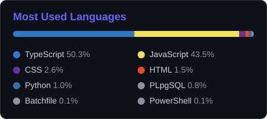

<!-- ═══════════════════════════ HEADER ═══════════════════════════ -->
<p align="center">
  
</p>

<p align="center">
  <a href="https://portfolio-eta-liard-84.vercel.app/">
    
  </a>
</p>

<p align="center">
  <a href="https://portfolio-eta-liard-84.vercel.app/"></a>
  <a href="https://www.linkedin.com/in/HamzaEzzouek"></a>
  <a href="mailto:hamzaezz2803@gmail.com"></a>
  
</p>

<br/>

<!-- ═══════════════════════════ ABOUT ═══════════════════════════ -->
<table>
<tr>
<td width="55%" valign="top">

### Bonjour, je suis Hamza 👋

Développeur **Full-Stack Web & Mobile** et élève ingénieur en **Sciences des Données & Développement Informatique** à l'ESTEM.

Je conçois des produits **complets et évolutifs** — du schéma de base de données jusqu'à l'interface — avec un focus sur les **SaaS**, les **CRM** et l'**intégration de l'IA** dans les workflows métier.

- 🔭 Dernier projet : **Qarizmi OS**, SaaS modulaire (CRM, IA, automatisations)
- 🌱 En ce moment : Next.js App Router, Supabase RLS, LLMs
- 🌍 Arabe · Français · Anglais
- 📍 Casablanca, Maroc

</td>
<td width="45%" valign="top">

```ts
const hamza = {
  role: "Full-Stack Developer",
  stack: {
    front:  ["Next.js", "React", "TS"],
    back:   ["Node.js", "Laravel", "Spring"],
    data:   ["Supabase", "MySQL", "MongoDB"],
    mobile: ["React Native", "Flutter"],
  },
  ai: ["Groq", "LLM workflows"],
  openTo: ["Stage", "CDI", "Freelance"],
};
```

</td>
</tr>
</table>

<!-- ═══════════════════════════ FEATURED ═══════════════════════════ -->
## ⚡ Projet phare

<table>
<tr>
<td>

#### 🧠 Qarizmi OS — Plateforme SaaS modulaire
<sub>Qarizmi · Stage Full-Stack · 2026</sub>

Plateforme multi-tenant regroupant **CRM**, **workflows IA** et **automatisations** (Slack, WhatsApp, Google).

- Module CRM complet : gestion des leads + **extraction de données par IA** (Groq)
- **Server Actions** sécurisées, isolation des données via **Supabase RLS multi-tenant**
- Qualité : tests **Vitest** + pipeline **CI** GitHub Actions

<p>
  
  
  
  
  
  
</p>

</td>
</tr>
</table>

<!-- ═══════════════════════════ STACK ═══════════════════════════ -->
## 🛠️ Stack technique

<table>
  <tr>
    <td align="right" width="150"><b>Frontend</b></td>
    <td></td>
  </tr>
  <tr>
    <td align="right"><b>Mobile</b></td>
    <td></td>
  </tr>
  <tr>
    <td align="right"><b>Backend</b></td>
    <td></td>
  </tr>
  <tr>
    <td align="right"><b>Data & Cloud</b></td>
    <td></td>
  </tr>
  <tr>
    <td align="right"><b>DevOps & Outils</b></td>
    <td></td>
  </tr>
</table>

<!-- ═══════════════════════════ EXPERIENCE ═══════════════════════════ -->
## 💼 Expérience

| Période | Entreprise | Rôle | Points clés |
|:--|:--|:--|:--|
| **06/2026 – 09/2026** | **Qarizmi** | Développeur Full-Stack · Stage | SaaS modulaire, CRM + IA, Supabase RLS multi-tenant, Next.js 16 |
| **04/2025 – 07/2025** | **Muntadaacom** | Stage PFE · Licence GL | Application web de gestion RH, architectures logicielles modernes |
| **11/2024 – 02/2025** | **FSJES Casablanca** | Développeur Web | Site du Laboratoire d'Études Transversales en Droit, Économie & Management |
| **02/2024 – 05/2024** | **All Formations** <sub>(Remote · FR)</sub> | Stage PFE | Plateforme d'adoption d'animaux — React, Tailwind, Laravel, MySQL |

<!-- ═══════════════════════════ PROJECTS ═══════════════════════════ -->
## 🚀 Projets

<table>
<tr>
<td width="50%" valign="top">

#### 📊 Statistiques & Bilans — PCM
Tableaux de bord et bilans financiers selon le **Plan Comptable Marocain**, en web et mobile.

  

</td>
<td width="50%" valign="top">

#### 🏫 Gestion d'école
Application de gestion scolaire : élèves, classes, enseignants et notes.

  

</td>
</tr>
<tr>
<td width="50%" valign="top">

#### 📰 App mobile d'actualités
Application Flutter consommant une **API REST** d'actualités en temps réel.

 

</td>
<td width="50%" valign="top">

#### 🎓 Gestion des formations
Plateforme full-stack de gestion des formations, inscriptions et sessions.

  

</td>
</tr>
<tr>
<td width="50%" valign="top">

#### 🧑‍🎓 Gestion des étudiants
Services web **REST (JAX-RS)** et **SOAP** pour la gestion des étudiants.

  

</td>
<td width="50%" valign="top">

#### 🐾 Adoption d'animaux
Plateforme d'adoption avec back-office, réalisée en stage (remote, France).

  

</td>
</tr>
</table>

<p align="center">
  <a href="https://portfolio-eta-liard-84.vercel.app/"></a>
</p>

<!-- ═══════════════════════════ STATS ═══════════════════════════ -->
## 📈 Activité GitHub

<p align="center">
  
  
</p>

<p align="center">
  
</p>

<p align="center">
  
</p>

<p align="center">
  <picture>
    <source media="(prefers-color-scheme: dark)" srcset="https://raw.githubusercontent.com/hamzaezz2803-star/hamzaezz2803-star/output/github-snake-dark.svg"/>
    <source media="(prefers-color-scheme: light)" srcset="https://raw.githubusercontent.com/hamzaezz2803-star/hamzaezz2803-star/output/github-snake.svg"/>
    
  </picture>
</p>

<!-- ═══════════════════════════ EDUCATION ═══════════════════════════ -->
## 🎓 Formation

| Année | Diplôme | École |
|:--|:--|:--|
| 2025 – 2026 | Cycle Ingénieur — Sciences des Données & Développement Informatique | **ESTEM** |
| 2024 – 2025 | Licence Professionnelle — Génie Logiciel | **ESTEM** |
| 2023 – 2024 | Bac+2 Développement Digital, option Web Full-Stack | **CFP Elhassania** |

<!-- ═══════════════════════════ CONTACT ═══════════════════════════ -->
## 🤝 Travaillons ensemble

<p align="center">
  Je suis <b>ouvert aux opportunités de stage, d'emploi et de freelance</b> en développement Full-Stack.<br/>
  Un projet, une question ou juste envie d'échanger ? Écrivez-moi.
</p>

<p align="center">
  <a href="mailto:hamzaezz2803@gmail.com"></a>
  <a href="https://www.linkedin.com/in/HamzaEzzouek"></a>
  <a href="https://portfolio-eta-liard-84.vercel.app/"></a>
</p>

<p align="center">
  
</p>

<!-- ═══════════════════════════ FOOTER ═══════════════════════════ -->
<p align="center">
  
</p>
